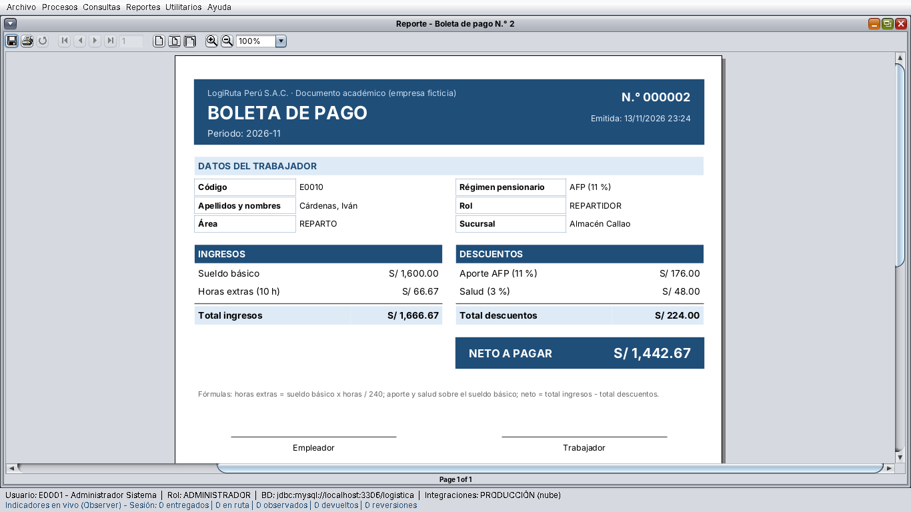
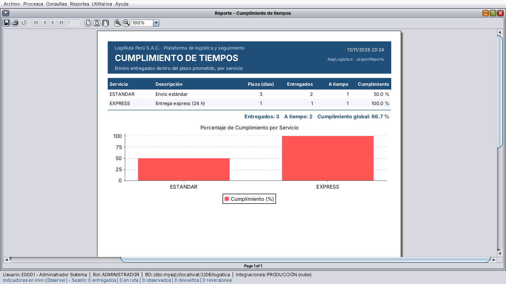
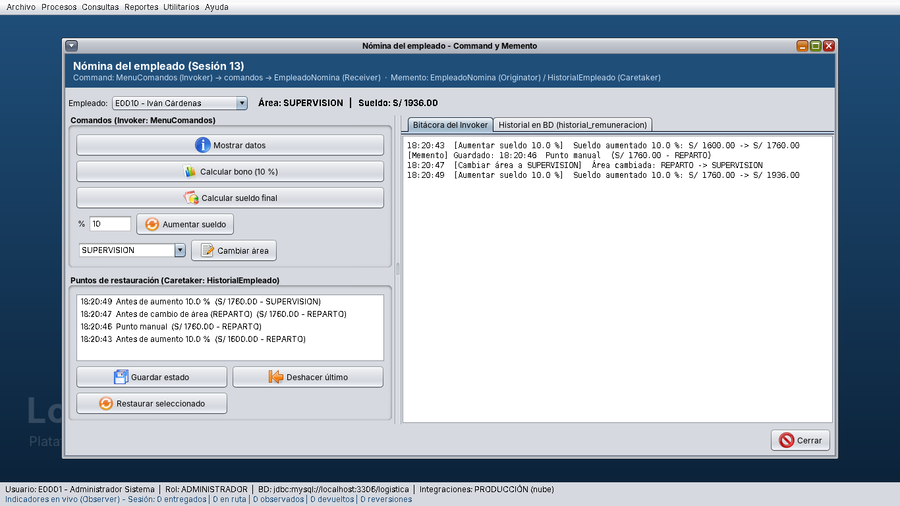

# AppLogistica – Plataforma de logística y seguimiento de envíos

Proyecto final del curso **Diseño de Patrones** (Facultad de Ingeniería, ciclo 2026-II).
Aplicación de escritorio en **Java Swing (Apache NetBeans + Ant)** con base de datos **MySQL 8** y reportes
**JasperReports**, para la empresa ficticia **LogiRuta Perú S.A.C.** Aplica principios **SOLID** y patrones **GoF**
creacionales, estructurales y de comportamiento.

> Estado: **Avance 3 – Capítulos I al VIII, actualizado a la semana 17**: antipatrones (semana 14) y patrones GRASP
> Experto en información, Fabricación pura y Polimorfismo (semana 17) con la nueva **boleta de pago**. Los
> capítulos IX al XII (implementación final, pruebas, conclusiones y recomendaciones) se completan en la entrega final.

El repositorio sigue la misma organización que el proyecto de ejemplo del docente (**AppEmpresa**): el proyecto
NetBeans está en la raíz, las librerías en `lib/runtime`, los scripts en `sql/` y los diagramas en `diagramas/`.

---

## Contenido del repositorio

```
PlataformaLogistica_Patrones/
├── build.xml, manifest.mf, nbproject/   Proyecto NetBeans/Ant (abrir esta carpeta)
├── db.properties                        Conexión a MySQL (usuario logistica / logistica)
├── src/uni/
│   ├── controller   Controladores, Facade, Invokers (GestorComandos, MenuComandos)
│   ├── dao          Acceso a datos con procedimientos almacenados
│   ├── database     AccesoDB (Singleton) y prueba de conexión
│   ├── entity       Transfer Objects y enumeraciones
│   ├── formularios  Ventanas Swing (LoginView = clase principal)
│   ├── reportes     Bridge + 6 plantillas JasperReports (.jrxml)
│   ├── service      Lógica de negocio y patrones
│   └── util         Builder, Factory, Adapters, Caretakers y pruebas por consola
├── lib/runtime/     JasperReports 6.21.3, mysql-connector-j 8.4.0 y dependencias
├── sql/
│   ├── 01_instalacion_inicial.sql       Crea la base "logistica" completa con datos de prueba
│   ├── 02_actualizacion_sesion13.sql    Actualiza una base del Avance 2 sin borrar datos
│   └── 03_actualizacion_semana17.sql    Agrega régimen AFP/SNP y boletas de pago (después del 02)
├── diagramas/       Fuentes PlantUML (.puml) e imágenes: BD, arquitectura, Bridge, Sesiones 13, 14 y 17
├── docs/
│   ├── Informe_AppLogistica_Avance3_Cap_I-VIII.docx / .pdf
│   ├── reportes_ejemplo/   Los reportes Jasper (con gráficos) y una boleta de pago en PDF
│   ├── capturas/           Capturas de la aplicación
│   ├── diagramas_uml.md    Código Mermaid de los diagramas del informe
│   ├── salida_pruebas.txt  Salida de las pruebas por consola
│   └── caso_empresarial.txt
├── INFORME_Y_PRUEBAS.md     Cambios de la versión y pruebas realizadas
└── subir_a_github.bat       Publica los cambios en GitHub (Windows)
```

## Requisitos

- JDK 17 o superior (el proyecto compila con `source/target 11`).
- Apache NetBeans 17 o superior.
- MySQL Server 8 y MySQL Workbench.
- No se necesita descargar librerías: JasperReports, el conector de MySQL y sus dependencias ya están en
  `lib/runtime` y el proyecto las referencia con rutas relativas.

## Instalación y ejecución

1. **Clonar** el repositorio (o descargar el ZIP y extraerlo completo):
   ```bash
   git clone https://github.com/alexandra585/PlataformaLogistica_Patrones.git
   ```
2. **Base de datos**
   - *Instalación nueva:* abrir `sql/01_instalacion_inicial.sql` en MySQL Workbench (usuario root) y ejecutarlo
     completo (rayo). Crea la base `logistica`, el usuario `logistica` / `logistica`, tablas, procedimientos, triggers,
     vistas y **datos precargados**. Si se ejecuta de nuevo, borra y recrea la base.
   - *Ya tengo una base anterior con mis datos:* ejecutar en orden `sql/02_actualizacion_sesion13.sql` y
     `sql/03_actualizacion_semana17.sql` (no borran datos y pueden ejecutarse más de una vez).
3. **Abrir el proyecto:** en NetBeans, *File › Open Project* y seleccionar la carpeta del repositorio
   (la que contiene `build.xml` y `nbproject`).
4. **(Opcional)** Si MySQL usa otro puerto o usuario, editar `db.properties`. La clave
   `integraciones=CONTINGENCIA` cambia la familia de proveedores externos (Abstract Factory).
5. **Probar la conexión:** clic derecho sobre `uni.database.prueba` › *Run File*.
6. **Ejecutar:** *Clean and Build* y luego *Run Project* (F6). Se abre `uni.formularios.LoginView`.

Desde consola (con Ant): `ant clean jar` y luego `java -jar dist/AppLogistica.jar`.

## Usuarios de prueba

| Usuario | Contraseña | Rol | Uso sugerido |
|---|---|---|---|
| admin | admin | ADMINISTRADOR | Todas las opciones (incluye Nómina, Boleta de pago y Reportes) |
| rquispe | 123456 | AGENTE_VENTANILLA | Clientes y registro de envíos |
| lmendoza | 123456 | OPERADOR_ALMACEN | Recoger, clasificar, manifiestos |
| jtorres | 123456 | SUPERVISOR_RUTA | Manifiestos, reportes, alertas, revertir entregas |
| icardenas | 123456 | REPARTIDOR | Envíos asignados LR00000004 y LR00000005 |
| mhuaman | 123456 | REPARTIDOR | Envío asignado LR00000008 |
| csalazar | 123456 | REPARTIDOR | De vacaciones: el patrón State le niega el acceso |

Las contraseñas se guardan con hash SHA-256.

---

## Patrones y principios aplicados

| Categoría | Patrón / principio | Dónde se aplica |
|---|---|---|
| SOLID | SRP, OCP, LSP, ISP, DIP | Servicios de envío, `ILectura`/`IEscritura`, `IRegistroRemuneracion`, inyección por constructor |
| Creacional | Singleton | `AccesoDB`, `SesionUsuario`, `ConfiguracionSistema` |
| Creacional | Factory | `ServicioEnvioFactory` (express, estándar, programado, recojo en tienda, interprovincial) |
| Creacional | Abstract Factory | `FabricaIntegracionProduccion` / `FabricaIntegracionContingencia` |
| Creacional | Builder | `EnvioBuilder`, `DirectorEnvio` |
| Creacional | Prototype | `EnvioTo.clone()`, `RegistroPlantillas` ("Repetir último envío") |
| Estructural | Adapter | Correo, SMS, WhatsApp, Google Maps, OpenStreetMap |
| Estructural | Facade | `RegistroEnvioFacade` |
| Estructural | Decorator | Tarifa + seguro, embalaje frágil, firma digital, GPS |
| Estructural | Composite | Manifiesto › sacos/paletas › paquetes |
| Estructural | Proxy | `SeguimientoServiceProxy` (protección por rol, caché y auditoría) |
| Estructural | Bridge | `Reporte` (6 reportes Jasper) × `ISalidaReporte` (visor, PDF, impresora) |
| Comportamiento | State | 9 estados del envío (`EnvioContexto`) y estado laboral del empleado |
| Comportamiento | Observer | Persistencia, historial, notificación, alertas, indicadores y pantalla en vivo |
| Comportamiento | Command | `GestorComandos` (envíos: deshacer/rehacer, cola sin conexión, macro) y `MenuComandos` (nómina, Sesión 13) |
| Comportamiento | Memento | `EnvioMemento` + `HistorialMementos`; `EmpleadoMemento` + `HistorialEmpleado` (Sesión 13) |
| Antipatrones | Caso Empleado (Sesión 14) | `EmpleadoAntipatron` (solo didáctico) frente a `DescuentoStrategy` + `DescuentoFactory` + `ParametrosPlanilla` |
| GRASP | Experto en información | `EmpleadoNomina` calcula horas extras, descuentos y sueldo neto |
| GRASP | Fabricación pura | `GeneradorBoleta`, `BoletaDao` (también `AccesoDB` y los DAO) |
| GRASP | Polimorfismo | `DescuentoStrategy` → `DescuentoAFP` / `DescuentoSNP` (también estados, servicios y salidas de reporte) |

## Semana 13: Command y Memento sobre el empleado

Se replicó el ejemplo de clase (`Comando`, `MenuComandos`, `Empleado`, `EmpleadoMemento`, `Historial`) dentro de la
arquitectura del proyecto, incluido el **ejercicio resuelto `AumentarSueldoCommand`**:

| Rol | Clase en AppLogistica |
|---|---|
| Command | `uni.service.IComandoEmpleado` |
| Comandos concretos | `MostrarDatosCommand`, `CalcularBonoCommand`, `CalcularSueldoCommand`, `AumentarSueldoCommand`, `CambiarAreaCommand` |
| Invoker | `uni.controller.MenuComandos` |
| Receiver / Originator | `uni.service.EmpleadoNomina` |
| Memento | `uni.service.EmpleadoMemento` |
| Caretaker | `uni.util.HistorialEmpleado` |
| Cliente | `uni.formularios.NominaEmpleadoView` |

En la aplicación: **Archivo › Nómina del empleado (Command/Memento)** o el botón *Nómina* en **Archivo › Empleados**.
Cada aumento o cambio de área guarda antes un memento, y todo cambio queda registrado en la tabla
`historial_remuneracion`.

## Semanas 14 y 17: antipatrones y GRASP (boleta de pago)

- **Antipatrones (Cap. VII del informe):** un antipatrón no se implementa; se identifica y se corrige. Se documentan
  los de desarrollo (God Object, Spaghetti Code, Big Ball of Mud, Shotgun Surgery, Vendor Lock-In, Golden Hammer,
  Magic Numbers, Copy-Paste, Lava Flow, Singletonitis) y los organizacionales, y se replica el caso de clase del
  Empleado: `uni.util.EmpleadoAntipatron` (versión con errores) frente a la versión refactorizada con Strategy y
  Factory Method. Ambas calculan el mismo neto (S/ 2254.17).
- **Boleta de pago (Cap. VIII):** **Archivo › Boleta de pago (GRASP)** o el botón *Boleta* en Empleados. Se elige el
  periodo, las horas extras y el régimen (AFP 11 % o SNP 6 %, más salud 3 %); *Calcular* muestra la vista previa y
  *Emitir* la registra en `boletas_pago` y la abre en el visor de JasperReports.

## Aportes del equipo

- Búsqueda modal del remitente al registrar un envío (`ClienteBuscarDialog`).
- Gráficos de barras en los seis reportes JasperReports.
- Opción **Archivo › Cerrar sesión**.

## Reportes con JasperReports

**Reportes › Reportes (JasperReports)**: se elige el reporte, el filtro y la salida (visor, archivo PDF o impresora).
Igual que en AppEmpresa, cada `.jrxml` se compila al abrir el reporte y se llena con la conexión a MySQL.

| Reporte | Plantilla | Filtro |
|---|---|---|
| Lista de empleados | `listaEmpleados.jrxml` | — |
| Listado de envíos | `listadoEnvios.jrxml` | Estado (opcional) |
| Manifiesto de carga | `manifiestoCarga.jrxml` | Código de manifiesto (ej. MF-2026-0458) |
| Cumplimiento de tiempos | `cumplimientoTiempos.jrxml` | — |
| Incidencias por zona | `incidenciasZona.jrxml` | — |
| Productividad de reparto | `productividadReparto.jrxml` | — |
| Boleta de pago (Sesión 17) | `boletaPago.jrxml` | Boleta emitida |

Los seis PDF generados con los datos precargados están en [`docs/reportes_ejemplo`](docs/reportes_ejemplo).

## Dónde ver cada patrón de comportamiento

- **Procesos › Seguimiento y estados del envío** (buscar `LR00000012` o `LR00000004`): State, Command
  (deshacer/rehacer y modo sin conexión), Memento (puntos de restauración) y Observer (eventos en vivo).
- **Procesos › Manifiesto de carga:** árbol Composite y despacho con MacroComando.
- **Archivo › Nómina del empleado:** Command + Memento de la Sesión 13.
- **Archivo › Empleados › Estado laboral:** State + Observer de la Sesión 12.
- **Utilitarios › Alertas, notificaciones y bitácora:** lo registrado por observadores y comandos.

## Pruebas por consola (no requieren MySQL)

- `uni.util.PruebaPatrones` – capítulos III al VI (incluye la Sesión 13 y genera dos PDF Jasper en `salida_reportes/`).
- `uni.util.PruebaComportamiento` – solo patrones de comportamiento.
- `uni.util.PruebaGrasp` – antipatrones (Sesión 14) y GRASP (Sesión 17); genera `salida_reportes/boleta_pago.pdf`.

La salida está en [`docs/salida_pruebas.txt`](docs/salida_pruebas.txt) y el detalle de las pruebas en
[`INFORME_Y_PRUEBAS.md`](INFORME_Y_PRUEBAS.md).

## Capturas

| Boleta de pago (GRASP) | Reporte Jasper con gráfico | Nómina: Command + Memento |
|---|---|---|
|  |  |  |

Más capturas en [`docs/capturas`](docs/capturas).

## Documentación

- Informe del avance: [`docs/Informe_AppLogistica_Avance3_Cap_I-VIII.pdf`](docs/Informe_AppLogistica_Avance3_Cap_I-VIII.pdf)
- Diagramas PlantUML: [`diagramas/`](diagramas) · Diagramas Mermaid del informe: [`docs/diagramas_uml.md`](docs/diagramas_uml.md)

---

Proyecto académico desarrollado con fines educativos para el curso Diseño de Patrones.
