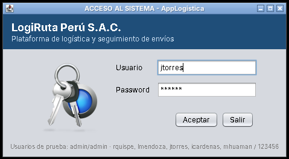
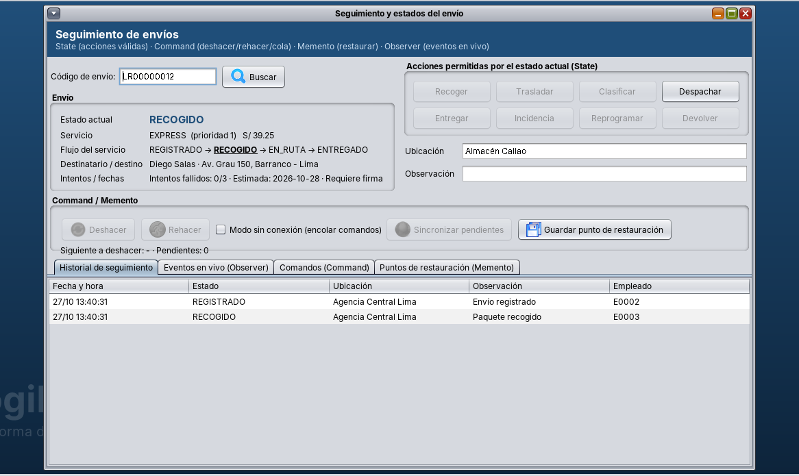
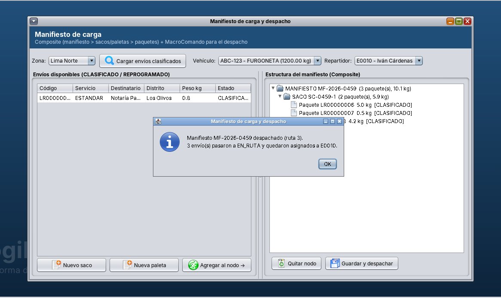

# AppLogistica – Plataforma de logística y seguimiento de envíos

Proyecto final del curso **Diseño de Patrones** (Facultad de Ingeniería, ciclo 2026-II).
Aplicación de escritorio en **Java (Apache NetBeans)** con base de datos **MySQL 8** para la empresa ficticia
**LogiRuta Perú S.A.C.**, que aplica principios **SOLID** y patrones **GoF** creacionales, estructurales y de comportamiento.

> Estado: **Avance 2 – Capítulos I al VI** (hasta la semana 13 del sílabo: Command y Memento).
> Los capítulos VII al XII (antipatrones, GRASP, implementación final, pruebas, conclusiones y recomendaciones) se desarrollan en las siguientes entregas.

---

## Contenido del repositorio

```
PlataformaLogistica_Patrones/
├── AppLogistica/              Proyecto NetBeans (Java 11+)
│   ├── src/uni/controller     Controladores, Facade e Invoker de comandos
│   ├── src/uni/dao            Acceso a datos MySQL (procedimientos almacenados)
│   ├── src/uni/database       AccesoDB (Singleton) y prueba de conexión
│   ├── src/uni/entity         Transfer Objects y enumeraciones
│   ├── src/uni/formularios    Ventanas Swing (LoginView = clase principal)
│   ├── src/uni/reportes       Reportes (Bridge)
│   ├── src/uni/service        Lógica de negocio y patrones
│   ├── src/uni/util           Builder, Factory, Adapters, utilitarios y pruebas
│   ├── lib/                   Driver JDBC (MariaDB Connector/J, compatible con MySQL 8)
│   └── db.properties          Configuración de la conexión
├── base_datos/
│   └── base_Datos_logistica.sql   Script completo de la BD "logistica"
└── docs/
    ├── Informe_AppLogistica_Avance2_Cap_I-VI.docx / .pdf
    ├── diagramas_uml.md       Código Mermaid de todos los diagramas
    ├── salida_pruebas.txt     Evidencia de las pruebas por consola
    ├── caso_empresarial.txt   Caso de estudio del curso
    └── capturas/              Capturas de la aplicación
```

La estructura de paquetes replica la del proyecto de referencia del curso, **AppEmpresa**
(`uni.controller`, `uni.dao`, `uni.database`, `uni.entity`, `uni.formularios`, `uni.reportes`, `uni.service`, `uni.util`).

---

## Requisitos

- JDK 17 o superior (el proyecto compila con `source/target 11`)
- Apache NetBeans 17 o superior
- MySQL Server 8 y MySQL Workbench

## Instalación y ejecución

1. **Clonar el repositorio**
   ```bash
   git clone https://github.com/alexandra585/PlataformaLogistica_Patrones.git
   ```
2. **Crear la base de datos:** abrir `base_datos/base_Datos_logistica.sql` en MySQL Workbench (usuario root) y ejecutarlo completo.
   El script crea la base `logistica`, el usuario de conexión `logistica` / `logistica`, tablas, procedimientos almacenados,
   triggers, vistas y datos de prueba. Puede ejecutarse de nuevo para reiniciar los datos.
3. **Abrir el proyecto:** en NetBeans, *File › Open Project* y seleccionar la carpeta `AppLogistica`.
4. **(Opcional) Configurar la conexión:** si MySQL usa otro puerto o usuario, editar `AppLogistica/db.properties`.
   La clave `integraciones=CONTINGENCIA` cambia la familia de proveedores externos (patrón Abstract Factory).
5. **Probar la conexión:** clic derecho sobre `uni.database.prueba` › *Run File*.
6. **Ejecutar:** *Run Project* (F6). Se abre `uni.formularios.LoginView`.

Desde consola (con Ant): `ant jar` y luego `java -jar dist/AppLogistica.jar` dentro de la carpeta `AppLogistica`.

> El driver incluido en `lib/` es MariaDB Connector/J 2.7.6 (funciona con MySQL 8). Si se prefiere el conector oficial,
> basta con copiar `mysql-connector-j-8.x.jar` en `lib/` y agregarlo a las librerías del proyecto: `AccesoDB` lo detecta solo.

## Usuarios de prueba

| Usuario | Contraseña | Rol | Uso sugerido |
|---|---|---|---|
| admin | admin | ADMINISTRADOR | Todas las opciones |
| rquispe | 123456 | AGENTE_VENTANILLA | Clientes y registro de envíos |
| lmendoza | 123456 | OPERADOR_ALMACEN | Recoger, clasificar, manifiestos |
| jtorres | 123456 | SUPERVISOR_RUTA | Manifiestos, reportes, alertas, revertir entregas |
| icardenas | 123456 | REPARTIDOR | Envíos asignados LR00000004 y LR00000005 |
| mhuaman | 123456 | REPARTIDOR | Envío asignado LR00000008 |
| csalazar | 123456 | REPARTIDOR | De vacaciones: el patrón State le niega el acceso |

Las contraseñas se guardan con hash SHA-256 en la base de datos.

---

## Patrones y principios aplicados

| Categoría | Patrón / principio | Dónde se aplica |
|---|---|---|
| SOLID | SRP, OCP, LSP, ISP, DIP | Servicios de envío, interfaces `ILectura`/`IEscritura`, inyección por constructor |
| Creacional | Singleton | `AccesoDB`, `SesionUsuario`, `ConfiguracionSistema` |
| Creacional | Factory | `ServicioEnvioFactory` (express, estándar, programado, recojo en tienda, interprovincial) |
| Creacional | Abstract Factory | `FabricaIntegracionProduccion` / `FabricaIntegracionContingencia` |
| Creacional | Builder | `EnvioBuilder`, `DirectorEnvio` |
| Creacional | Prototype | `EnvioTo.clone()`, `RegistroPlantillas` ("Repetir último envío") |
| Estructural | Adapter | Correo, SMS, WhatsApp, Google Maps, OpenStreetMap |
| Estructural | Facade | `RegistroEnvioFacade` |
| Estructural | Decorator | Tarifa + seguro, embalaje frágil, firma digital, GPS |
| Estructural | Composite | Manifiesto › sacos/paletas › paquetes |
| Estructural | Proxy | `SeguimientoServiceProxy` (protección por rol, caché y auditoría) |
| Estructural | Bridge | Reportes × formatos (pantalla, HTML, CSV) |
| Comportamiento | State | 9 estados del envío (`EnvioContexto`) y estado laboral del empleado |
| Comportamiento | Observer | Persistencia, historial, notificación, alertas, indicadores y pantalla en vivo |
| Comportamiento | Command | `GestorComandos`: deshacer/rehacer, cola sin conexión, macro-comando de manifiesto |
| Comportamiento | Memento | `EnvioMemento` + `HistorialMementos` (puntos de restauración) |

## Dónde ver cada patrón de comportamiento en la aplicación

- **Procesos › Seguimiento y estados del envío** (buscar `LR00000012` o `LR00000004`):
  botones habilitados según el estado (State), Deshacer/Rehacer y modo sin conexión (Command),
  puntos de restauración (Memento) y pestaña de eventos en vivo (Observer).
- **Procesos › Manifiesto de carga:** árbol Composite y despacho con MacroComando.
- **Utilitarios › Alertas, notificaciones y bitácora:** lo registrado por observadores y comandos.
- **Archivo › Empleados › Estado laboral (State):** State + Observer aplicados al empleado.

## Pruebas por consola (no requieren MySQL)

- `uni.util.PruebaPatrones` – capítulos III al VI
- `uni.util.PruebaComportamiento` – solo patrones de comportamiento

La salida se encuentra en [`docs/salida_pruebas.txt`](docs/salida_pruebas.txt).

## Capturas

| Login | Seguimiento (State) | Manifiesto (Composite + Command) |
|---|---|---|
|  |  |  |

Más capturas en [`docs/capturas`](docs/capturas).

## Documentación

- Informe del avance: [`docs/Informe_AppLogistica_Avance2_Cap_I-VI.pdf`](docs/Informe_AppLogistica_Avance2_Cap_I-VI.pdf)
- Diagramas UML (Mermaid): [`docs/diagramas_uml.md`](docs/diagramas_uml.md)

---

Proyecto académico desarrollado con fines educativos para el curso Diseño de Patrones.
